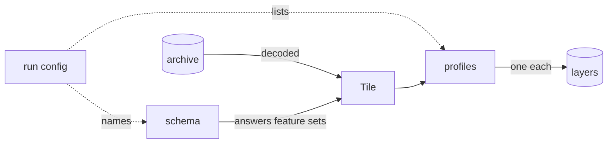

# Core concepts

The ideas tilealchemist is built on, and why they have their shape.

A **run** builds a set of layers in one pass. `convert` decodes each tile of
the **archive** into a `Tile`, through which the run's **schema** answers
questions about the data, and hands it to every **profile**. Each profile
returns one tile of its **layer**.

## The run config says what, the command line says where

The run config holds what a run builds: profiles, schema, zoom range,
attribution, plugins. The archive and how the work is spread are
command-line arguments. So one run config works on a small extract, on a
planet, and in tilealchemist-pipeline. Only the zoom range also has flags,
to try a run config at low zoom levels without editing it.

## Profiles ask for feature sets, not layers

A profile asks for a **feature set** such as `WATERWAYS`, and the schema
decides which features answer it. One profile therefore reads every schema
that provides the feature set, and a misspelled one fails at import instead
of producing an empty layer hours later.

## Schemas are code, and a run names its schema

Archives differ in structure, not just in names. OpenMapTiles keeps water
polygons and waterway lines in separate layers; Protomaps mixes polygons,
lines and points in one `water` layer. So a schema is a class with one
method per feature set. Both schemas have a `water` layer, so reading an
archive with the wrong one wouldn't fail, it would build wrong layers. That
is why a run names its schema and `convert` checks the archive's metadata
before the first tile.

## One tile stands for every copy of its content

PMTiles stores identical tiles once, as one **blob**; thousands of ocean
tiles can share it. tilealchemist builds one `Tile` per blob and uses its
output for every tile ID that shares it. So a `Tile` has no z/x/y, a
profile's output depends only on the tile's content, profiles keep no state
between tiles, and values derived from a tile, such as its water, are
computed once for all profiles.

## Profiles are files, plugins are packages

A profile is a plain file named by its path: it needs no packaging, and is
loaded in every process and copied to every pipeline worker. A plugin is an
installed package, because everything must share one copy of it: profiles
import its feature sets, and every process looks up its schema by name.

## Attribution belongs to the run

OpenStreetMap's license requires attribution, so every layer carries one,
by default the archive's. The run sets it, not the profile: the credit
belongs to the data and to whoever runs the build, and a profile can't know
which archive it will read.

## Gaps

A **gap** is a tile ID the archive has no tile for. OpenFreeMap leaves out
empty tiles; Protomaps leaves out none. `convert` builds nothing for gaps.
tilealchemist-pipeline does: it hands the profile an empty `Tile`, which
the land profile turns into a full square of land.
